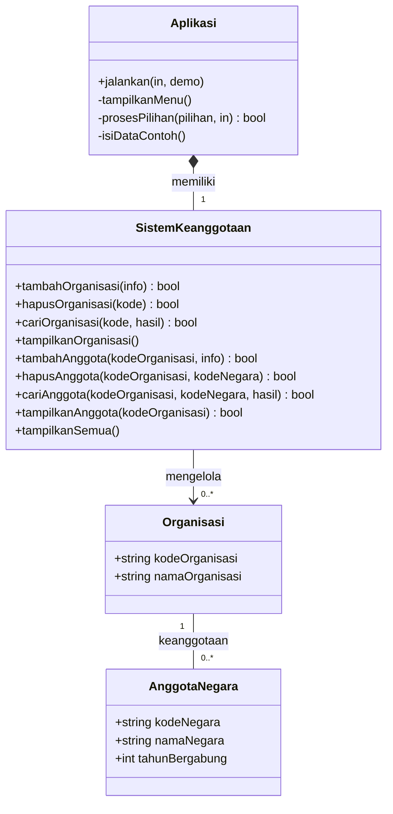
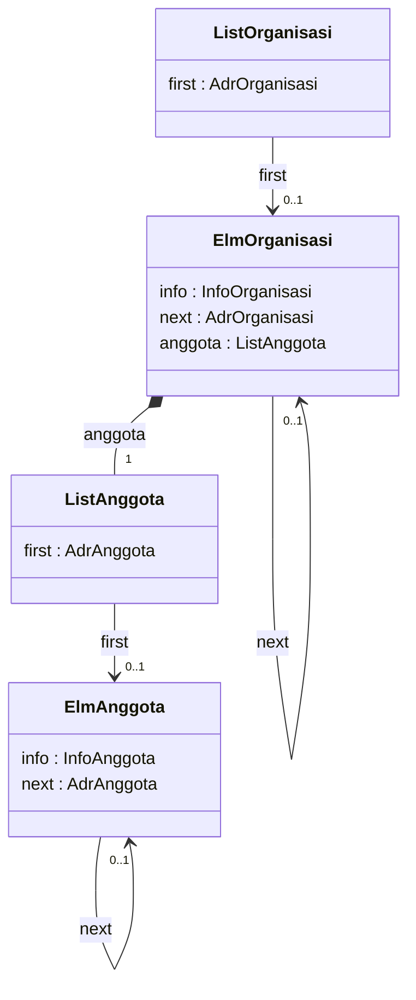
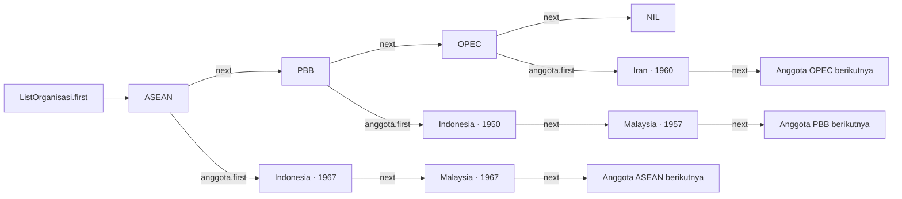

# Laporan Tugas Besar Struktur Data

**Sistem Anggota Himpunan Kenegaraan**

Program Studi S1 Rekayasa Perangkat Lunak

| Keterangan | Data |
| --- | --- |
| Kelompok | Gw EsEr |
| Ketua | Fanan Agfian Mozart |
| Anggota | Raihan Yassar Tsaqib |

## Tujuan

Menerapkan Multi Linked List (MLL) dalam C++ untuk menyimpan organisasi antarnegara dan daftar negara anggotanya. Kami menguji operasi tambah, hapus, cari, dan tampilkan pada list organisasi serta list anggota, termasuk saat list kosong atau tinggal satu elemen.

## Studi kasus

Sebuah organisasi antarnegara bisa mempunyai banyak negara anggota. Satu negara juga bisa tergabung dalam beberapa organisasi dengan tahun bergabung yang berbeda. Program membantu pengguna melihat organisasi yang tercatat, mencari sebuah negara dalam organisasi tertentu, dan memperbarui daftar anggota lewat menu terminal.

| Elemen | Data yang disimpan | Aturan |
| --- | --- | --- |
| Organisasi (parent) | Kode organisasi, nama organisasi | Kode unik pada list utama. Organisasi dapat dibuat tanpa anggota. |
| Keanggotaan negara (child) | Kode negara, nama negara, tahun bergabung | Kode negara unik dalam satu organisasi. Kode yang sama dapat digunakan pada organisasi lain. Tahun berupa bilangan bulat positif. |

Kode dibandingkan persis setelah spasi di tepi masukan dibuang. Data disimpan di memori selama program berjalan. Mode demo menyediakan **3 parent dan 15 child** (5 child per parent). Data demo adalah cuplikan historis untuk pengujian. Tahun bergabung menunjukkan tahun masuk pertama atau tahun pendirian untuk anggota pendiri.

## Diagram class proyek

`Aplikasi` mengurus menu dan masukan. `SistemKeanggotaan` menerapkan aturan data serta menggunakan operasi MLL untuk penyimpanan. `Organisasi` dan `AnggotaNegara` adalah tipe data domain yang diimplementasikan sebagai `struct` C++.



## Diagram ADT Multi Linked List

Rancangan memakai dua tingkat Singly Linked List (SLL). `ListOrganisasi.first` menunjuk parent pertama. Setiap `ElmOrganisasi` memiliki `ListAnggota` sendiri. `InfoOrganisasi` dan `InfoAnggota` adalah nama tipe yang dipakai ADT untuk data `Organisasi` dan `AnggotaNegara`.



`AdrOrganisasi` menunjuk ke `ElmOrganisasi` dan `AdrAnggota` menunjuk ke `ElmAnggota`. Pada C++, `NIL` ditulis sebagai `nullptr`. Saat list kosong, `first` bernilai `NIL`. Pada node terakhir, `next` bernilai `NIL`.

Cuplikan struktur dalam mode demo. Indonesia di ASEAN dan Indonesia di PBB disimpan pada alamat yang berbeda.



## Implementasi C++

| Bagian | Kode lengkap |
| --- | --- |
| Tipe data dan deklarasi primitif | [mll.hpp](include/mll.hpp) |
| Operasi linked list dan dealokasi | [mll.cpp](src/mll.cpp) |
| Aturan penambahan, pencarian, penghapusan, dan kepemilikan data | [sistem_keanggotaan.hpp](include/sistem_keanggotaan.hpp), [sistem_keanggotaan.cpp](src/sistem_keanggotaan.cpp) |
| Program utama, menu, validasi masukan, dan data demo | [main.cpp](src/main.cpp), [aplikasi.hpp](include/aplikasi.hpp), [aplikasi.cpp](src/aplikasi.cpp) |
| Pengujian operasi | [uji_mll.cpp](tests/uji_mll.cpp) |

| Operasi brief | Implementasi | Menu |
| --- | --- | --- |
| Buat dan tambah parent | `createParent`, `insertParent` | 1 |
| Hapus parent | `deleteParent`, `destroyParent` | 2 |
| Cari dan cetak parent | `findParent`, `printParent` | 3, 4 |
| Buat dan tambah child ke parent tertentu | `createChild`, `insertChild` | 5 |
| Hapus child dari parent tertentu | `deleteChild` | 6 |
| Cari dan cetak child berdasarkan parent | `findChild`, `printChild` | 7, 8 |
| Cetak seluruh struktur | `printAll` | 9 |

Fungsi `createParent` dan `createChild` mengalokasikan node dengan `next = NIL`. Penyambungan dilakukan pada fungsi `insert`. Jika list kosong, `first` menunjuk node baru. Jika list berisi data, fungsi berjalan sampai node terakhir, lalu menyambungkan `next` node tersebut ke node baru.

Penghapusan diawali dengan mencari node berdasarkan kode sambil menyimpan alamat node sebelumnya. Jika node berada di awal list, `first` dipindahkan ke node berikutnya. Jika node berada di tengah atau di akhir, `next` node sebelumnya diarahkan ke penerus node yang dihapus. Setelah dilepas, `next` node yang dihapus diatur ke `NIL` dan alamatnya dikembalikan untuk didealokasi. Penghapusan parent membebaskan semua node dalam child list miliknya sebelum parent dibebaskan.

Pada list anak, `insertChild` dan `deleteChild` langsung mengubah `parent.anggota.first` bila posisi awal berubah. Pola ini mengadaptasi model *list of lists* pada materi MLL. Contoh di slide memakai list lokal `L3` pada beberapa prosedur. Dalam implementasi ini, perubahan dilakukan pada list milik parent agar pointer kepala yang baru langsung tersimpan.

## Hasil pengujian

Program dikompilasi di Windows dengan GCC 14.2.0 (MinGW) dan CMake 3.31.5 dalam mode C++17. Kompilasi berhasil dengan peringatan `-Wall -Wextra -Wpedantic` diperlakukan sebagai error. Cara mengulang build dan pengujian ada di [README](README.md).

Keluaran `uji_mll.exe` yang diperoleh melalui CTest:

```text
LULUS: operasi parent dan urutan traversal
LULUS: operasi child dan kasus batas
LULUS: pemisahan keanggotaan dan cetak seluruh struktur
```

| Skenario yang dijalankan | Hasil |
| --- | --- |
| Cari, hapus, dan tampilkan pada list parent kosong | Pencarian dan penghapusan menyatakan data tidak ada. Tampilan memberi pesan daftar kosong. |
| Tambah dan cari beberapa parent, lalu tampilkan | Data ditemukan dan parent tercetak sesuai urutan penambahan. Kode parent duplikat ditolak. |
| Hapus parent di tengah, akhir, awal, dan saat tersisa satu node | Node yang tersisa dapat ditemukan. Setelah node terakhir dihapus, list kembali kosong. |
| Tambah, cari, hapus, dan cetak child pada parent tertentu | Child ditemukan dengan tahun yang tepat. Data duplikat dan tahun nol ditolak. List anak tetap tersambung ketika node tengah, akhir, atau awal dilepas. |
| Hapus satu-satunya child atau cari child yang sudah dihapus | Daftar kembali kosong. Child yang sudah dihapus tidak ditemukan. |
| Masukkan negara yang sama pada dua organisasi dengan tahun berbeda | Dua catatan dapat dicetak. Setelah satu catatan atau parent-nya dihapus, keanggotaan pada parent yang lain tetap dapat ditemukan. |
| Jalankan pilihan menu 0–9 dengan alur tambah, cari, tampilkan, dan hapus | Semua pilihan menghasilkan pesan yang diharapkan. Teks pada prompt angka, pilihan di luar menu, dan masukan kosong ditangani. Program juga selesai saat input terputus. |
| Jalankan mode demo lalu pilih 9 | Tampil tiga organisasi, masing-masing diikuti tepat lima anggota. |

Keluaran mode demo setelah memilih menu 9:

```text
Pilihan: [ASEAN] Perhimpunan Bangsa-Bangsa Asia Tenggara
  - [IDN] Indonesia | Tahun bergabung: 1967
  - [MYS] Malaysia | Tahun bergabung: 1967
  - [PHL] Filipina | Tahun bergabung: 1967
  - [SGP] Singapura | Tahun bergabung: 1967
  - [THA] Thailand | Tahun bergabung: 1967
[PBB] Perserikatan Bangsa-Bangsa
  - [IDN] Indonesia | Tahun bergabung: 1950
  - [MYS] Malaysia | Tahun bergabung: 1957
  - [JPN] Jepang | Tahun bergabung: 1956
  - [CAN] Kanada | Tahun bergabung: 1945
  - [AUS] Australia | Tahun bergabung: 1945
[OPEC] Organisasi Negara-Negara Pengekspor Minyak
  - [IRN] Iran | Tahun bergabung: 1960
  - [IRQ] Irak | Tahun bergabung: 1960
  - [KWT] Kuwait | Tahun bergabung: 1960
  - [SAU] Arab Saudi | Tahun bergabung: 1960
  - [VEN] Venezuela | Tahun bergabung: 1960
```

## Analisis

Hasil traversal mengikuti urutan penambahan karena node baru disambungkan di akhir list. Pencarian berjalan berurutan dari `first` sampai kode cocok atau pointer mencapai `NIL`. Untuk membaca seluruh struktur, `printAll` menelusuri setiap organisasi lalu menelusuri list anggotanya.

Jika **P** adalah jumlah organisasi, **C** jumlah anak pada satu organisasi dan **T** jumlah anak pada seluruh organisasi, penambahan dan pencarian parent membutuhkan waktu terburuk **O(P)**. Operasi child dari menu membutuhkan **O(P + C)** karena program mencari organisasinya lebih dulu. Penghapusan parent juga **O(P + C)** karena program membersihkan semua child milik parent yang dihapus. Pencetakan seluruh struktur membutuhkan **O(P + T)**.

Kasus penghapusan kepala memperlihatkan mengapa pointer `first` perlu diperbarui pada list aslinya. Jika list hanya punya satu node, nilai `next` node tersebut sudah `NIL`, sehingga memindahkan `first` ke `next` otomatis membuat list kosong. Dua catatan Indonesia dengan tahun berbeda memperlihatkan bahwa setiap organisasi memiliki list anak yang independen.

## Kesimpulan

MLL dapat merepresentasikan daftar organisasi dengan jumlah anggota yang dapat berbeda pada tiap organisasi. Operasi wajib berjalan pada data kosong, satu elemen, dan banyak elemen. Program dapat menampilkan seluruh struktur serta memperbarui keanggotaan sebuah negara secara terpisah pada setiap organisasi.

## Referensi
- [ASEAN — The Founding of ASEAN](https://asean.org/the-founding-of-asean/).
- [United Nations — Growth in United Nations membership](https://www.un.org/en/about-us/growth-in-un-membership). Tahun 1957 untuk Malaysia mengikuti penerimaan Federasi Malaya.
- [OPEC — Lima negara pendiri OPEC pada 1960](https://www.opec.org/pr-detail/18-14-sep-2024.html).
